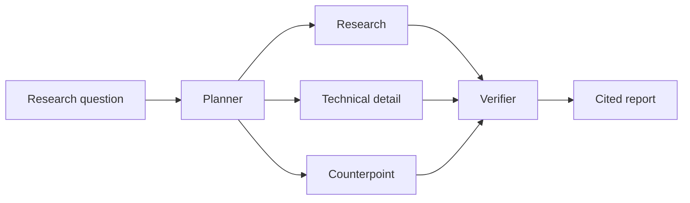

# Sift

Sift is a small research agent that checks its evidence before it writes the final answer.

The project focuses on a common research-assistant failure mode: retrieval alone does not tell you whether a generated claim is actually supported by what was retrieved. Sift splits the work into planning, parallel research, verification, and writing so those steps are visible instead of being hidden inside one prompt.

## What it does

Given a research question, Sift:

1. breaks the question into general research, technical detail, and counterpoint tasks;
2. runs those tasks in parallel through LangGraph;
3. retrieves evidence from a local knowledge base;
4. checks each proposed claim against its cited evidence;
5. drops unsupported claims before writing a cited report.

The included corpus is intentionally small. It is there to make the repository runnable and the evaluation reproducible. The same retrieval interface can be replaced with an embedding-backed store or an external search tool for a larger deployment.



## Why I structured it this way

The main design choice is separating research from verification. A researcher is allowed to propose a useful claim. A different step decides whether the evidence actually supports it. That makes the system a little slower and more expensive in API mode, but it creates a clean place to inspect unsupported claims and measure groundedness.

The graph is also deliberately bounded. The agents do not keep handing work back and forth until they decide they are done. The workflow has explicit state and a known stopping point, which makes traces easier to understand and failed runs easier to reproduce.

More detail is in [docs/ARCHITECTURE.md](docs/ARCHITECTURE.md).

## Stack

- Python 3.11+
- LangGraph for orchestration and parallel fan-out
- LangChain model and document interfaces
- LangSmith-compatible tracing and experiments
- scikit-learn TF-IDF retrieval for the local demo corpus
- FastAPI for the API
- Streamlit for the demo UI
- Docker / Docker Compose
- pytest

## Run it locally

Create a virtual environment and install the project:

```bash
python -m venv .venv
source .venv/bin/activate
pip install -e ".[dev]"
cp .env.example .env
```

Sift defaults to offline mode, so the first run does not need an API key:

```bash
sift "When is RAG a better fit than fine-tuning for a support assistant?"
```

Offline mode uses the real LangGraph workflow and retriever, but replaces model reasoning with deterministic behavior. It is useful for tests and for inspecting the graph without paying for model calls.

To use an LLM, update `.env`:

```text
SIFT_MODE=api
OPENAI_API_KEY=...
SIFT_MODEL=gpt-4.1-mini
```

Then run the same command again.

## API and UI

Start the API:

```bash
uvicorn sift.api.app:app --reload
```

The research endpoint is `POST /research` with:

```json
{
  "question": "What is the tradeoff of adding a verifier to a research agent?"
}
```

In another terminal, start the UI:

```bash
streamlit run sift/ui/app.py
```

Or run both with Docker Compose:

```bash
docker compose up --build
```

The API will be available on port `8000` and the UI on `8501`.

## Evaluation

A simple single-pass RAG baseline sits next to the agent workflow because a more complicated graph should have to earn its complexity.

Run both on the included evaluation set:

```bash
python -m sift.evals.run --mode baseline --out results/baseline.json
python -m sift.evals.run --mode sift --out results/sift.json
```

The current deterministic checks cover expected-keyword recall, citation presence, unsupported citation rate, and latency. See [EVALUATION.md](EVALUATION.md) for the reasoning behind the setup and the optional LangSmith experiment runner.

Benchmark claims are intentionally not hard-coded into this README. Results should come from the exact model and configuration used for a run.

## LangSmith

Set these values in `.env` if you want traces:

```text
LANGSMITH_TRACING=true
LANGSMITH_API_KEY=...
LANGSMITH_PROJECT=sift
```

The useful trace boundaries are the planner, each research branch, verification, and report generation. Those boundaries make it possible to answer questions like:

- Did the planner create useful independent tasks?
- Did retrieval return evidence that actually matched each task?
- Which claims were rejected by verification?
- Did extra research improve quality enough to justify the added latency?

## Tests

```bash
pytest -q
```

The tests do not require an API key.

## Repository layout

```text
sift/
├── data/
│   ├── evals/             # small benchmark set
│   └── knowledge/         # local research corpus
├── docs/
│   └── ARCHITECTURE.md
├── sift/
│   ├── agents/            # planning, research, verification, writing
│   ├── api/
│   ├── evals/
│   ├── rag/
│   ├── ui/
│   ├── baseline.py
│   └── graph.py
├── tests/
├── Dockerfile
├── docker-compose.yml
├── EVALUATION.md
└── pyproject.toml
```

## Next things I would add

The local corpus is useful for a reproducible demo. The next meaningful extension is a search connector with source allow-listing and cached page content. After that, claim-level LLM judging can be added to test whether the counterpoint branch is actually improving reports or only adding cost.
