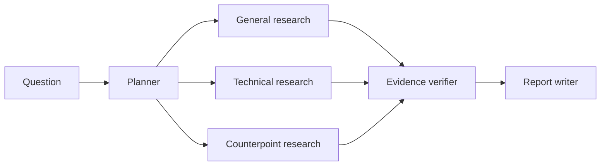

# Architecture

Sift keeps orchestration explicit. The planner creates three bounded research tasks. LangGraph fans those tasks out to the same research node in parallel. Each branch retrieves evidence independently and returns one focused finding. The verifier checks those findings against the retrieved source ids before the writer sees them.

## Why the verifier is separate

The research step is optimized for finding and proposing useful claims. Verification is deliberately separate so a claim does not pass simply because the same step that wrote it considers it plausible. This costs another model pass in API mode, but the boundary is easy to trace and evaluate.

## Why the graph is constrained

The agents do not chat with each other indefinitely. The graph has a small number of transitions and a clear stopping point. That makes failed runs easier to reproduce and avoids spending tokens on agent negotiation that does not improve the answer.

## Retrieval

The included corpus uses TF-IDF retrieval so the project runs offline and tests are deterministic. The retrieval interface is intentionally small; replacing it with an embedding-backed store does not change the graph contract. LangChain `Document` objects are exposed by the store for that migration path.
